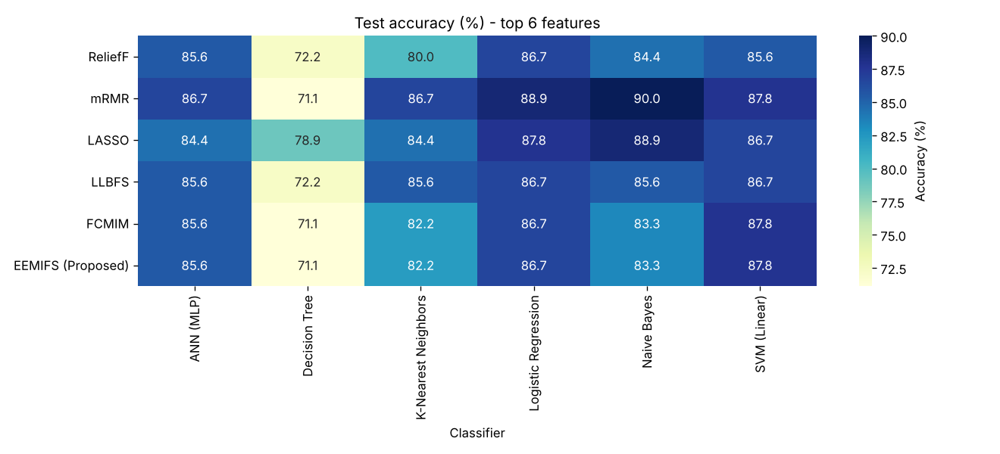
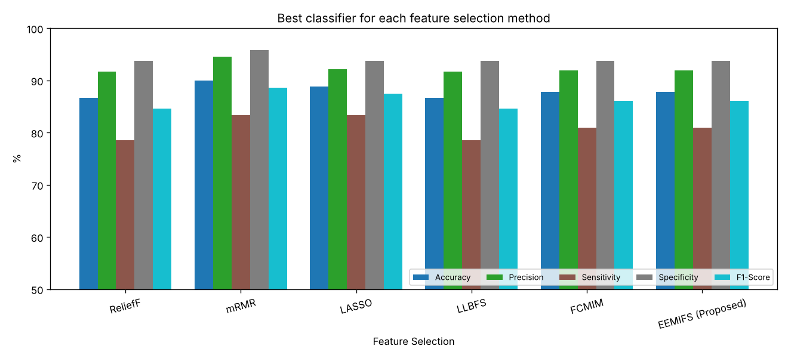
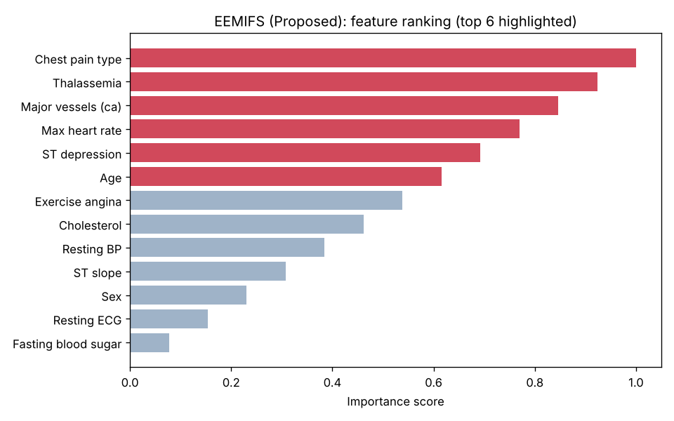
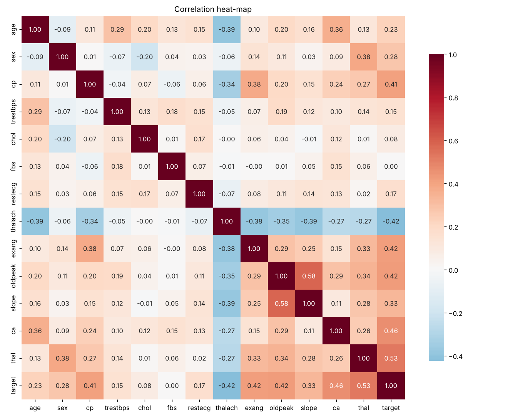

<h1 align="center">Heart Disease Identification using Machine Learning</h1>

<p align="center">
  Comparing six feature selection algorithms, including a proposed <b>Enhanced Ensemble Mutual Information Feature Selection (EEMIFS)</b> method, and six classifiers on the Cleveland heart disease dataset.
</p>

<p align="center">
  
  
  
  
</p>

---

## Overview

Heart disease is one of the leading causes of death worldwide. Catching it early depends on accurate diagnosis, which is costly and depends on expert judgement. This project builds a machine learning diagnosis pipeline that:

1. **Pre-processes** the Cleveland dataset (297 patients, 13 clinical features).
2. **Selects the most informative features** with six algorithms: ReliefF, mRMR, LASSO, LLBFS, FCMIM and the proposed **EEMIFS**.
3. **Trains six classifiers**: Logistic Regression, K-NN, ANN (MLP), SVM, Naive Bayes and Decision Tree.
4. **Evaluates** each combination with accuracy, precision, sensitivity, specificity, F1-score and MCC, on both a held-out test set and stratified 10-fold cross-validation.

The work builds on *Li et al., "Heart Disease Identification Method Using Machine Learning Classification in E-Healthcare", IEEE Access, 2020* ([DOI: 10.1109/ACCESS.2020.3001149](https://doi.org/10.1109/ACCESS.2020.3001149)).

## Proposed Method: EEMIFS

EEMIFS ([`src/feature_selection.py`](src/feature_selection.py)) improves on single-measure mutual information selection in four ways:

| Component | What it does |
|-----------|--------------|
| **Ensemble relevance** | Combines three information measures: histogram MI, k-NN (KSG) MI for non-linear dependence, and kernel MI (HSIC) |
| **Adaptive weighting** | Weights each measure by its stability (inverse coefficient of variation) |
| **Bootstrap stability** | Averages all scores over 30 bootstrap resamples to reduce variance |
| **Interaction + redundancy control** | Rewards synergistic feature pairs and penalises redundancy with features already selected, using a penalty that grows as more features are chosen |

## Pipeline

```
 Cleveland dataset ─► Drop missing values ─► Standard scaling ─► Feature selection (top-k)
       (297 x 13)                                                      │
                                                                       ▼
   Metrics & plots ◄── Test set / 10-fold CV ◄── Train 6 classifiers on selected features
```

## Results

All numbers below come from running `python main.py` (top-6 features, seed 42).

### Held-out test set (70 / 30 stratified split)

| Feature Selection | Best Classifier | Accuracy | Precision | Sensitivity | Specificity | F1 | MCC |
|---|---|:---:|:---:|:---:|:---:|:---:|:---:|
| ReliefF | Logistic Regression | 86.67 % | 91.67 % | 78.57 % | 93.75 % | 84.62 % | 0.736 |
| mRMR | Naive Bayes | **90.00 %** | 94.59 % | 83.33 % | 95.83 % | 88.61 % | 0.803 |
| LASSO | Naive Bayes | 88.89 % | 92.11 % | 83.33 % | 93.75 % | 87.50 % | 0.779 |
| LLBFS | Logistic Regression | 86.67 % | 91.67 % | 78.57 % | 93.75 % | 84.62 % | 0.736 |
| FCMIM | SVM (Linear) | 87.78 % | 91.89 % | 80.95 % | 93.75 % | 86.08 % | 0.757 |
| **EEMIFS (Proposed)** | SVM (Linear) | 87.78 % | 91.89 % | 80.95 % | 93.75 % | 86.08 % | 0.757 |
| *All 13 features (baseline)* | Naive Bayes | 87.78 % | 87.80 % | 85.71 % | 89.58 % | 86.75 % | 0.754 |

### Stratified 10-fold cross-validation

Feature selection is repeated inside every fold, so no test data leaks into the selection.

| Feature Selection | Best Classifier | Accuracy (mean ± std) | F1 | MCC |
|---|---|:---:|:---:|:---:|
| ReliefF | Logistic Regression | 83.86 ± 6.81 % | 82.02 % | 0.678 |
| mRMR | SVM (Linear) | 83.53 ± 7.06 % | 81.67 % | 0.670 |
| LASSO | Naive Bayes | 84.17 ± 9.46 % | 81.82 % | 0.683 |
| LLBFS | SVM (Linear) | 82.84 ± 6.72 % | 80.38 % | 0.660 |
| FCMIM | SVM (Linear) | 83.18 ± 5.83 % | 81.15 % | 0.664 |
| **EEMIFS (Proposed)** | Logistic Regression | 83.49 ± **5.58** % | 81.43 % | 0.671 |

**Key findings**

- With only **6 of the 13 features**, all selectors match or beat the all-features baseline. The models are simpler and faster with no loss in accuracy.
- EEMIFS has the **lowest variance across folds** (± 5.58 %), so it is the most stable selector, which is what its bootstrap ensemble design aims for.
- Every method agrees on the strongest predictors: **chest pain type, thalassemia, number of major vessels (ca), ST depression and max heart rate**.
- On a 90-patient test set, one prediction changes accuracy by about 1.1 %. Cross-validation is therefore the more reliable basis for comparison.

### Figures

| Accuracy of every selector × classifier | Best model per selector |
|:---:|:---:|
|  |  |
| **EEMIFS feature ranking** | **Feature correlation heat-map** |
|  |  |

## Repository Structure

```
heart-disease-prediction-ml/
├── main.py                    # End-to-end experiment runner
├── src/
│   ├── feature_selection.py   # ReliefF, mRMR, LASSO, LLBFS, FCMIM, EEMIFS
│   └── models.py              # Classifiers and evaluation metrics
├── data/
│   └── heart_cleveland.csv    # 297 x 13 Cleveland dataset (+ target)
├── results/                   # Generated CSV tables and figures
└── requirements.txt
```

## Getting Started

```bash
git clone https://github.com/SujithPG-coder/heart-disease-prediction-ml.git
cd heart-disease-prediction-ml
pip install -r requirements.txt

python main.py              # full run: hold-out + 10-fold CV (about 1 minute)
python main.py --top-k 8    # keep 8 features instead of 6
python main.py --no-cv      # hold-out evaluation only
```

All tables are written to `results/*.csv` and all plots to `results/figures/`.

## Dataset

The [UCI Heart Disease, Cleveland subset](https://archive.ics.uci.edu/dataset/45/heart+disease) (Janosi, Steinbrunn, Pfisterer & Detrano, 1988), licensed CC BY 4.0. It has 303 records; 6 with missing values are removed, leaving 297. The target is binarised (0 = no disease, 1 = disease present).

| Feature | Description | Feature | Description |
|---|---|---|---|
| `age` | Age in years | `thalach` | Maximum heart rate achieved |
| `sex` | 1 = male, 0 = female | `exang` | Exercise-induced angina |
| `cp` | Chest pain type (1–4) | `oldpeak` | ST depression induced by exercise |
| `trestbps` | Resting blood pressure | `slope` | Slope of peak exercise ST segment |
| `chol` | Serum cholesterol | `ca` | Number of major vessels (0–3) |
| `fbs` | Fasting blood sugar > 120 mg/dl | `thal` | Thalassemia (3, 6, 7) |
| `restecg` | Resting ECG result | `target` | Heart disease (0 / 1) |

## Tech Stack

**Language:** Python · **Libraries:** scikit-learn, NumPy, pandas, SciPy, Matplotlib, Seaborn · **Concepts:** information theory, feature selection, supervised classification, cross-validation

## Author

**Sujith Krishna P G**

<a href="https://github.com/SujithPG-coder"></a>
<a href="https://www.linkedin.com/in/sujithkrishnapg/"></a>

## License

Code is released under the [MIT License](LICENSE). The dataset is from the UCI Machine Learning Repository (CC BY 4.0).
